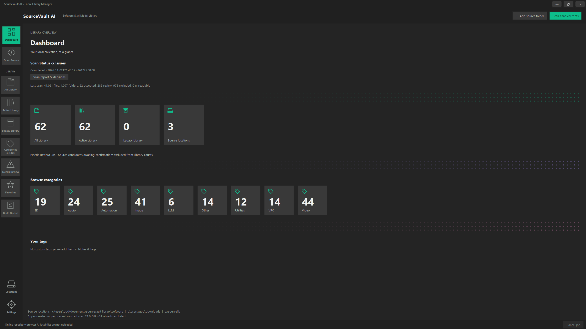
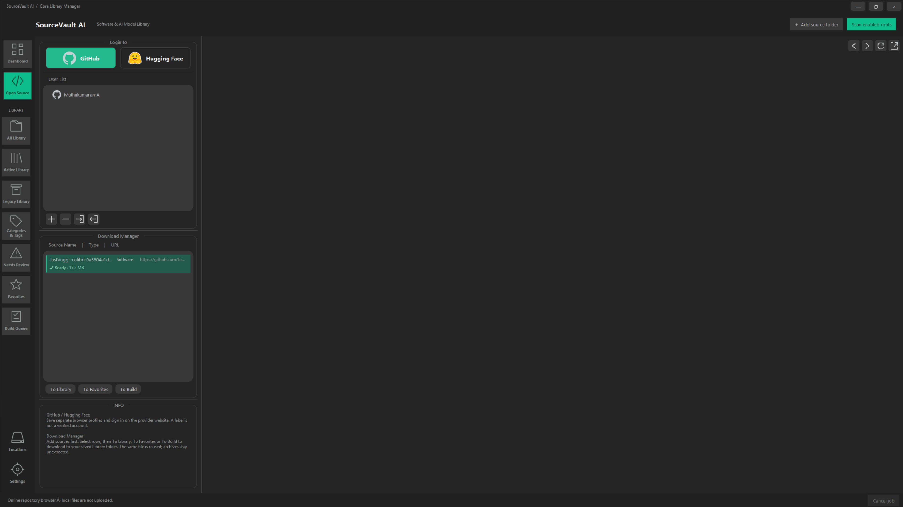
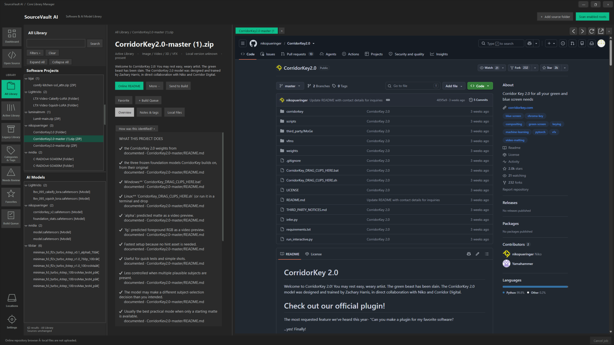
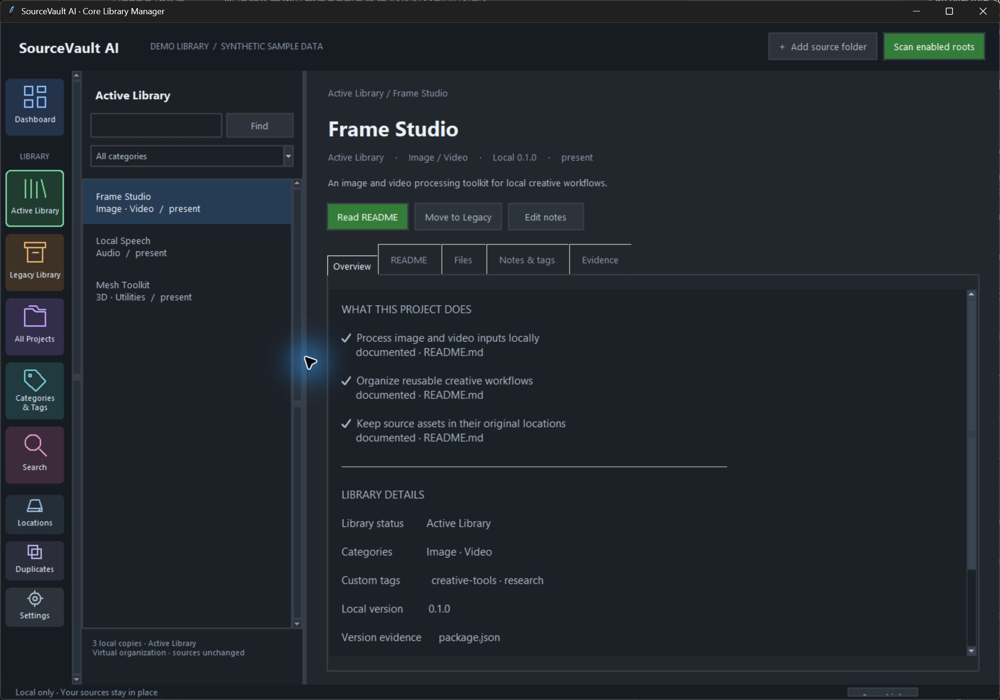
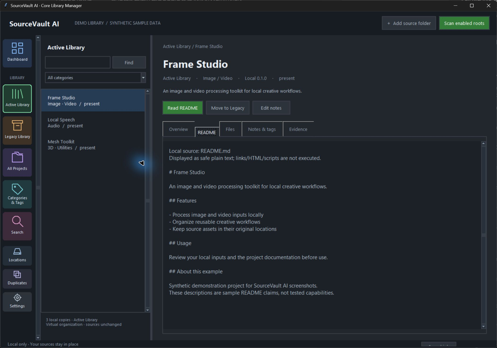
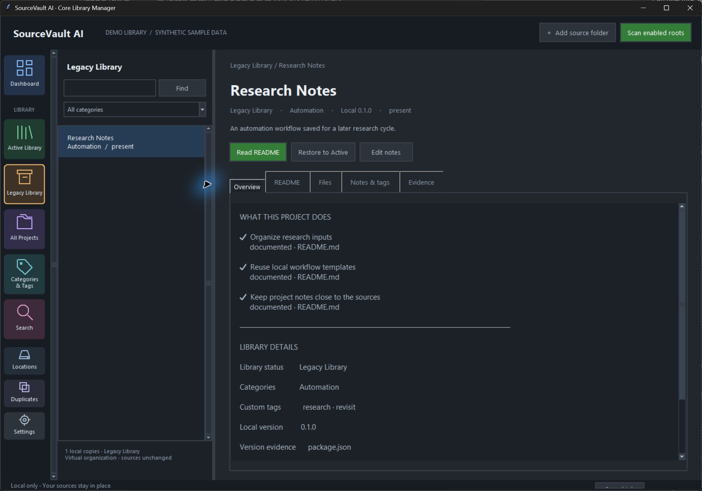

 

# SourceVault AI

### 🚧 IN DEVELOPMENT — EARLY PREVIEW

**An offline-first Windows desktop library for source projects, repositories, and AI model files.**

[The Vision](#the-vision) · [Interface Preview](#interface-preview) · [Product Direction](#product-direction) · [Roadmap](#roadmap) · [Availability](#source-code--availability)

---

## 🚧 In Development

**SourceVault AI is an early-stage project under active development. It is not a stable public release.**

The interface, features, and workflows are evolving as development continues. Full bug testing, broader validation, and release-readiness checks are still pending.

This repository showcases the product vision and visual progress. Application source code and binaries are not publicly distributed at this stage.

---

## The Vision

### Your Open-Source Universe. Organized.

You download a promising repository, an interesting AI model, or a useful source archive.

Months later, the files are still there — but remembering their purpose, origin, version, and why you saved them becomes increasingly difficult.

**SourceVault AI** aims to transform scattered software projects, AI models, repositories, and archives into a unified, intelligent, searchable desktop library.

Designed with a broader technology ecosystem in mind — including AI, robotics, VFX, simulation, 3D, automation, and software development.

**Download freely. Explore intelligently. Keep track of what matters.**

---

## Interface Preview

Explore the visual evolution of **SourceVault AI**, from the initial Core Library Manager interface to the latest development workspace.

> [!IMPORTANT]
> **Development builds — not production releases.**
>
> These screenshots document ongoing interface development. Features shown may be incomplete, experimental, or subject to change. Screenshots are not proof of production readiness or successful operation of every displayed project.
>
> Some project names, descriptions, and other information may be demonstration data.

### Development Gallery

<strong>✨ UI Version 2 — Current Development Preview | November 2026</strong>

 

The latest development interface introduces a refined workspace with improved library navigation, scan visibility, integrated source browsing, and a more detailed project inspection experience.

### 01 — Library Dashboard

A consolidated view of the local source collection, including library statistics, scan results, categorized projects, and source locations.

### 02 — Open-Source Browser

An integrated workspace for accessing GitHub and Hugging Face, organizing source downloads, and navigating repository resources.

### 03 — Project Inspector & Repository Viewer

A unified project workspace featuring detected capabilities, documentation evidence, categories, local project information, and an embedded repository viewer.

 

**Version 2 Highlights**

- Refined dark desktop interface.
- Enhanced library navigation and categorized browsing.
- Library scan overview and review indicators.
- Integrated GitHub and Hugging Face browsing workspace.
- Project information and capability inspection.
- Embedded repository and README viewing.
- Improved source discovery and project organization workflow.

*Captured from a working development build. Functionality remains under development and validation.*

 

<strong>🗂️ UI Version 1 — Previous Development Preview</strong>

 

The original development interface established the foundation for local source-library management, project inspection, documentation browsing, and personal organization.

### 01 — Dashboard

An initial overview of the personal source library.

### 02 — Active Library

An early look at browsing a project collection and reviewing project details.

### 03 — Local README Viewer

An early preview of reading locally available project documentation directly inside the workspace.

### 04 — Notes & Custom Tags

A preview of personal notes, labels, and project organization.

### 05 — Legacy Library

A preview of organizing projects that users want to set aside for possible future reference.

 

**Version 1 Highlights**

- Initial local library browsing interface.
- Active and Legacy Library navigation.
- Local documentation preview.
- Personal notes and tags.
- Early project overview and organization concepts.

*Previous development build — retained as part of the interface evolution history.*

 

> **Interface Evolution**
>
> Version 1 introduced the initial library experience.
>
> Version 2 expands the workspace with improved source navigation, scan visibility, repository browsing, and project inspection.
>
> Both versions are development previews, not separately released application versions.

---

## Product Direction

SourceVault AI is being developed as a personal workspace for discovering, understanding, organizing, and managing source projects across multiple storage locations.

The long-term product vision includes:

| Capability | Direction |
|---|---|
| 📁 **Unified Library** | Organize source projects, repositories, and model files across multiple drives. |
| 🧠 **Project Intelligence** | Understand project purpose, features, and capabilities. |
| 🔎 **Library Search** | Find projects by name, function, category, or personal tags. |
| 🏷️ **Custom Organization** | Organize collections using categories, notes, and custom labels. |
| 🔀 **Version Intelligence** | Identify local versions and track available repository updates. |
| 🗂️ **Duplicate Management** | Identify repeated archives, source copies, and redundant storage. |
| 📦 **Legacy Library** | Keep temporarily unused or older projects accessible without deleting them. |
| 🛡️ **File Management** | Support user-controlled source organization and storage operations. |
| 🔔 **Update Awareness** | Monitor relevant repository releases and changes. |
| 🌐 **Global Discovery** | Explore source projects through GitHub and Hugging Face. |
| ⚙️ **Build & Execution** | Introduce guided installation and execution workflows in later development stages. |

These represent the overall product direction. Individual features will be introduced and validated through development milestones.

---

## Roadmap

SourceVault AI follows a five-stage development roadmap.

| Stage | Development Phase | Focus |
|---|---|---|
| **01** | **Core Library Manager** | Establish the local library experience, source indexing, project browsing, and basic organization. |
| **02** | **Advanced Library Intelligence & Storage Manager** | Expand project analysis, version intelligence, duplicate management, and storage operations. |
| **03** | **Background Update Intelligence** | Introduce optional background monitoring, release awareness, and notifications. |
| **04** | **Global Open-Source Discovery** | Enable broader repository discovery and research across supported platforms. |
| **05** | **Installation, Build & Execution** | Introduce guided environment preparation, installation, building, and execution. |

**Current development focus: Stage 01 — Core Library Manager.**

Later stages describe planned capabilities and are not currently available features.

---

## Design Philosophy

### Local First. User Controlled.

SourceVault AI is being designed around several guiding principles:

- **Offline-first experience:** Local project information should remain accessible without requiring a continuous internet connection.
- **User-controlled organization:** Users decide how their projects are categorized, retained, or managed.
- **Source preservation:** Scanning and analysis should not silently modify original files.
- **Transparent information:** Project identification, feature analysis, and version information should communicate uncertainty where appropriate.
- **Extensible architecture:** The library foundation should support future intelligence, discovery, and execution capabilities.

These principles guide ongoing development and do not imply that every associated feature is already complete.

---

## Source Code & Availability

This repository currently serves as the **public project overview and development showcase**.

- Application source code and binaries are **not publicly distributed here at this stage**.
- Internal logic, architecture, implementation methods, and detailed development plans remain private.
- This page is a product showcase, not a technical specification.
- Public release timing, distribution, and licensing decisions have not been announced.
- Publicly visible project information does not imply that the application source has an open-source license.
- **SourceVault AI** remains the current working product name.

The project is under active development and is not yet available as a stable public release.

---

## Feedback Welcome

Early feedback can help shape future improvements.

We are particularly interested in feedback on:

- Managing source projects and downloaded repositories across multiple storage locations.
- Finding and understanding older downloads.
- Navigating large project libraries.
- Reviewing project documentation and metadata.
- Improving desktop interface clarity and usability.

Ideas and suggestions may inform future development. Discussions do not guarantee feature availability or changes to the current development scope.

---

### SourceVault AI

**Discover more. Organize smarter.**

*Your Open-Source Universe. Organized.*

**In development · Interface and features subject to change**

© 2026 SourceVault AI. All rights reserved.

