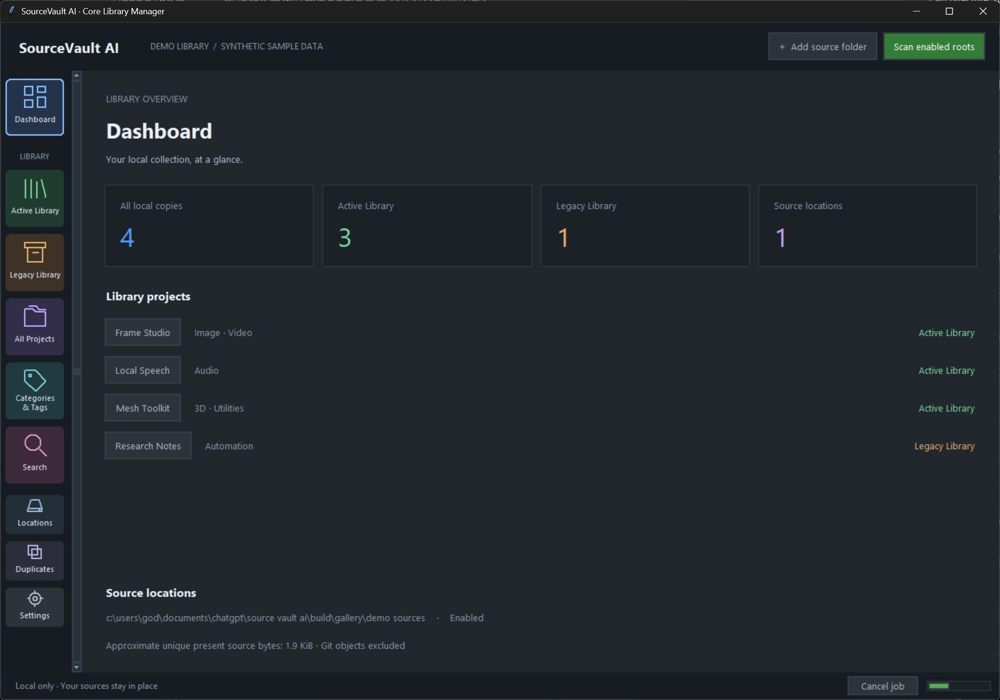
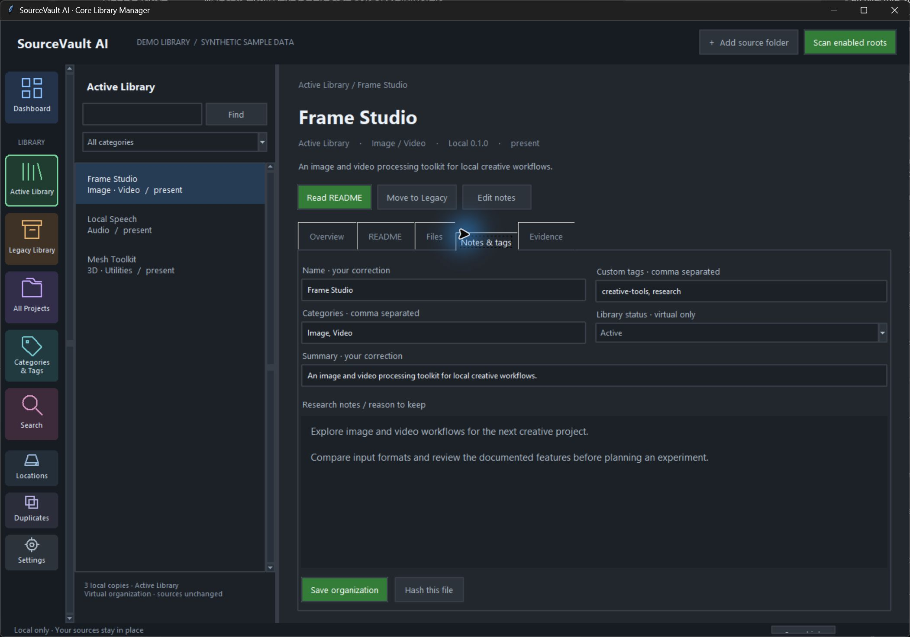

# SourceVault AI

### 🚧 IN DEVELOPMENT — EARLY PREVIEW

**An offline-first Windows desktop library for source projects, repositories and AI model files.**

[The vision](#the-vision) · [Interface preview](#early-development-preview) · [Prototype capabilities](#current-prototype) · [Roadmap](#five-stage-roadmap) · [Availability](#source-code--availability)

## 🚧 In Development

**SourceVault AI is an early-stage project under active development. It is not a stable public release.**

The interface, features and workflows are all works in progress and may change as development continues. Full bug testing, broader validation and release-readiness checks are still pending. This repository presents the product vision and early previews; it does not distribute the application source code or binaries.

## The vision

### Your Open-Source Universe. Organized.

You download a promising repository, an interesting model or a useful source archive. Months later, the files are still there—but the purpose, origin, version and reason you saved them are harder to remember.

SourceVault AI is being built to bring those scattered discoveries into one searchable local library. Projects can stay across Downloads, different drives and external storage, while their descriptions, locations, tags and research notes come together in one desktop workspace.

**Download freely. Explore intelligently. Keep track of what matters.**

| Find it again | Understand what you saved | Organize with control |
| :--- | :--- | :--- |
| Search local metadata, categories, tags and notes. | Review local README content, documented features and available version evidence. | Keep files in place, add your own context and set copies aside in the **Legacy Library**. |

## Early Development Preview

> [!IMPORTANT]
> **A first look—not a final interface or release.** These screenshots show an early development build using synthetic sample data. Both the interface and features may change. Full bug testing and validation are still pending; the images illustrate the initial direction, not production readiness or proof that the sample projects work.

### Active Library — Project Overview

A project list alongside its local summary, categories and documented feature evidence, with a resizable workspace and tabbed details.

<table>
<tr>
<td width="50%" valign="top">

### Dashboard — Library Overview

An overview of indexed copies, Active/Legacy status and registered source locations.

</td>
<td width="50%" valign="top">

### Legacy Library — Projects Set Aside for Later

A virtual place for temporarily unneeded projects. Changing status leaves the original files in place.

</td>
</tr>
<tr>
<td width="50%" valign="top">

### Local README — Offline Documentation Viewer

Read locally indexed documentation without needing an internet connection.

</td>
<td width="50%" valign="top">

### Notes &amp; Tags — Project Organization

Keep research reasons, custom tags, category corrections and library status with each project.

</td>
</tr>
</table>

*Captured from a working development build. Project names, descriptions and notes are demonstration content. Open any image to inspect it at full size.*

## Current prototype

**Stage 01 — Core Library Manager** is the current focus. These capabilities are present in the internal prototype and remain subject to further testing and refinement.

| Area | Prototype behavior |
| :--- | :--- |
| **Multi-location library** | Register multiple source folders and scan recursively, with controls for enabled roots and overlapping locations. |
| **Local source inspection** | Identify extracted projects, Git clones, model files/directories and supported archives without running their code. ZIP/TAR inspection is bounded; RAR/7z are detected but their contents are currently unsupported. |
| **Basic project context** | Extract descriptions, feature claims, language hints and local manifest versions using static evidence. Unknown and inferred results remain labeled. |
| **Offline documentation** | Display local README content as safe plain text, without script execution or remote image loading. |
| **Search & organization** | Search metadata, features, categories, tags and notes. Preserve user-authored annotations through refreshes. |
| **Active / Legacy Library** | Change a copy's virtual status without physically moving its source files. |
| **Exact-file duplicate information** | Hash individual files on demand and show matching hashes. No automatic keeper selection, cleanup or deletion. |
| **Catalog resilience** | Retain metadata for unavailable roots, track scan jobs/errors, and support metadata backup and validated restore. |
| **Desktop workspace** | Dark interface, single-column navigation, resizable project/details panes and tabbed project information. |

> [!NOTE]
> **AI is part of the product direction, not a completed capability claim.** The prototype currently uses an offline static-analysis fallback. A bundled generative model, cloud AI workflow, semantic search and verified official update intelligence are not available in this build.

### Still being validated

- Real multi-drive and removable-storage behavior, larger libraries and longer-running scans.
- Wider archive, filesystem edge-case and interrupted-operation testing.
- Interface usability, layout, accessibility and error handling across Windows environments.
- Packaging, clean-machine setup and the remaining Stage 01 acceptance requirements.

## Built around user control

| Principle | What it means |
| :--- | :--- |
| **Manage in place by default** | No requirement to consolidate every project into one folder. |
| **Non-destructive inspection** | Scanning, tags, notes and virtual status changes must not rewrite original source files. |
| **Local-first privacy** | The prototype makes no cloud AI calls. Future cloud analysis must require explicit consent before sending local contents. |
| **Evidence before certainty** | A README claim is not an execution test. A local version is not automatically the official latest release. Unknown remains unknown. |
| **Persistent annotations** | Refresh and reanalysis must not silently replace custom tags, notes or deliberate organization choices. |
| **Safe future file operations** | Reviewed copy/move and Recycle Bin-only cleanup belong to Stage 02. No automatic deletion or permanent-delete fallback is planned. |

**Legacy Library is a virtual status**, not a backup vault or a synonym for an obsolete version. A current project can be set aside there and restored to Active Library later.

## Five-stage roadmap

The roadmap contains **five stages**. Later-stage capabilities below are planned, not currently available.

| Stage | Focus | Planned scope | Status |
| :--- | :--- | :--- | :--- |
| **01** | **Core Library Manager** | Local scans, basic project context, offline README, metadata search, categories/tags/notes, Active/Legacy organization, informational exact-file hashes, catalog jobs and backups. | **In development** |
| **02** | **Advanced Library Intelligence & Storage Manager** | Advanced project/release/artifact/copy identity; official version evidence; deeper duplicates; reviewed physical copy/move; relinking; model variants; license/trust information; user-controlled Recycle Bin cleanup and applicable restore. | Planned |
| **03** | **Background Update Intelligence** | Opt-in tray/startup monitoring, scheduled official update checks, watchlists, digests, notifications, quiet hours and offline retry. | Planned |
| **04** | **Global Open-Source Discovery** | Attributed GitHub/Hugging Face discovery, task-oriented search, filters, comparisons, recommendations, research collections and conservative matching to local downloads. | Planned |
| **05** | **Installation, Build & Execution** | Compatibility guidance, dependency/environment preparation, reviewed install/build/launch commands, isolation where feasible, logs and recovery. | Planned |

**Stage 01 does not install, build or execute downloaded source projects.** Continuous update monitoring, global discovery and physical storage management are later-stage work.

## Source Code & Availability

This repository currently serves as the **public project overview and development showcase**.

- Application source code, binaries and technical implementation details are **not publicly distributed here at this stage**.
- Public release timing, distribution and licensing decisions have not been announced.
- Publicly visible project information does not imply that the application source has an open-source license.
- **SourceVault AI** remains the working product name.

## Feedback welcome

Early feedback can help shape the next iterations:

- Which local-library tasks are hardest to manage today?
- Does the navigation and project/details layout make sense?
- What should be easiest to find when returning to an old download?
- Which scanning or metadata edge cases need more validation?

Ideas can inform the existing roadmap; a discussion is not a promise of availability or a change to the current Stage 01 scope.

---

**SourceVault AI**  
*Discover more. Organize smarter.*

**In development · Interface and features subject to change**

© 2026 SourceVault AI. All rights reserved.

